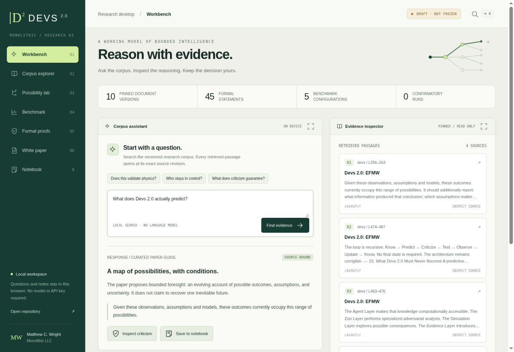

# Devs 2.0 — Research Desktop

<!-- ENUMINOUS-UNIFIED-NAV:START -->
## Repository navigation

**eNuminous network:** [All public repositories](https://github.com/enuminous/EFMW/blob/main/REPOSITORY_NAVIGATION.md) · [EFMW](https://github.com/enuminous/EFMW) · [102 equations](https://github.com/enuminous/Monolithic_102_EFMW) · [Frozen Lean](https://github.com/enuminous/Monolithic-102-Zoo-Lean4) · [Zoo](https://github.com/enuminous/Tortoise) · [Papers](https://github.com/enuminous/papers) · [Quantum geometry](https://github.com/enuminous/Base888-Quantum-Geometry)

**This project:** [Repository home](https://github.com/enuminous/Devs2.0) · [Subject index](https://github.com/enuminous/EFMW/blob/main/REPOSITORY_NAVIGATION.md#simulators-computation-and-experiments)

<details open>
<summary><strong>On this page</strong></summary>

- [Use the desktop](#use-the-desktop)
- [Build and verify](#build-and-verify)
- [Run the research protocol](#run-the-research-protocol)
- [What the formal work establishes](#what-the-formal-work-establishes)


</details>

**Related repositories:** [EFMW-EXP-001](https://github.com/enuminous/EFMW-EXP-001) · [Coherence-Prediction-Engine](https://github.com/enuminous/Coherence-Prediction-Engine) · [papers](https://github.com/enuminous/papers) · [EFMW](https://github.com/enuminous/EFMW) · [P-NP](https://github.com/enuminous/P-NP) · [oph-lab](https://github.com/enuminous/oph-lab) · [EFMW-Rule30](https://github.com/enuminous/EFMW-Rule30) · [OpenAI-math](https://github.com/enuminous/OpenAI-math)

> **Evidence boundary:** A link between projects is navigation, not an assertion of proven equivalence, experimental validation, or shared authorship. See each repository’s own status and review notes.
<!-- ENUMINOUS-UNIFIED-NAV:END -->


[Open the desktop](https://enuminous.github.io/Devs2.0/) · [White paper](Devs2.0-EFMW.md) · [Mathematics](docs/MATHEMATICS.md) · [DEV2-001](research/dev2-001/README.md) · [Build checks](https://github.com/enuminous/Devs2.0/actions)

A self-contained browser workspace for Matthew Chenoweth Wright's **Devs 2.0: EFMW**: a versioned corpus assistant, explicit uncertainty, inspectable criticism, human agency, and a reproducible architecture benchmark. The original research remains in [enuminous/papers](https://github.com/enuminous/papers/blob/f1c8f5d15e873174bad25a018adadd71557cb659/Devs2.0-EFMW.md).

**Acknowledgment:** [A thank-you to Alex Garland for *Devs*](https://github.com/enuminous/papers/blob/main/A-Thank-You-to-Alex-Garland-for-Devs.md), the series that helped inspire this project.

**DEV2-001 is DRAFT, NOT FROZEN. No confirmatory model experiment has run.** Matthew approved the **120 answerable / 240 absent / 120 contradictory** evaluation target and **20 percentage point** minimum absolute improvement. The follow-up fixes retain a 1,024-token Arm A output cap and common 8,192-token total cap, explicitly pin full prior outputs for both critic arms, and select a 12-point replication tolerance. Both independent runs must still satisfy the original pass gates. The reviewed holdout is not yet populated, and model/scoring pins are missing: [`dev2-001-v0.2-draft`](https://github.com/enuminous/Devs2.0/tree/dev2-001-v0.2-draft) is a tested checkpoint, not a frozen experiment. See the [decision record](research/dev2-001/APPROVALS.md).



## Use the desktop

Open `index.html` directly in a modern browser, or use the Pages link above. No npm dependencies, account, API key, analytics, or external script is required. The generated file embeds the paper, ten pinned document versions, prompts, and theorem catalog.

- **Workbench:** deterministic corpus retrieval, four curated paper guides, exact revision/line citations, and an inspectable mechanical criticism pass.
- **Corpus explorer:** search and read the pinned documents, including historical revisions.
- **Possibility lab:** change priors and likelihoods, apply observations, advance a posterior, expand the hypothesis set, and inspect entropy. Zero total mass is rejected.
- **Benchmark:** compare all five configurations, inspect unresolved gates, explore illustrative paired outcomes, and locally inspect an analysis JSON file.
- **Formal proofs:** search 45 Lean statements across seven modules and inspect their assumptions and source.
- **White paper and notebook:** read the full paper, retain research notes locally, and export/import a portable notebook.

The assistant is a **local retrieval and rules engine**, not a hosted language model. A retrieved quotation is not automatically evidence for a broader claim. The browser criticism pass is distinct from the model criticism tested by DEV2-001. Notebook storage is specific to a browser/origin; export it for backup. The site executes no external consequential actions.

## Build and verify

Requirements: Python **3.12.14**, Node **22.16.0**, Git, and Lean **4.28.0**. Python and JavaScript use only their standard libraries. Lean uses its bundled `Std`; there is no Mathlib dependency or unresolved proof placeholder.

```bash
git clone https://github.com/enuminous/Devs2.0.git
cd Devs2.0
python3 scripts/verify.py
lake build
python3 scripts/check_lean.py
python3 bench.py smoke --out /tmp/devs2-software-smoke
```

Install [Lean via its official instructions](https://lean-lang.org/install/) if `lake` is unavailable. `lean-toolchain` selects the exact release; `lakefile.toml` and `lake-manifest.json` define the library and `devs-check` executable. CI separately installs the official release archive with its pinned SHA-256 and runs all checks on a standard Ubuntu runner.

`python3 scripts/build_site.py` regenerates root `index.html`, the isolated `_site/` deployment directory, the theorem catalog, and the axiom audit. Edit `web/`, `Devs/`, or the source research package, then rebuild; do not edit generated HTML by hand. Pages deploys only `_site/` after software, Lean, audit, and fixture checks pass. [Deployment guide](docs/DEPLOYMENT.md).

The smoke command uses a deterministic **software fixture** and creates 60 responses plus blank scoring packets. It makes **zero model calls**, performs **zero human ratings**, and must remain `UNVERIFIED`. It is an integration check, not an experimental run.

## Run the research protocol

The [initial independent methods-review packet](reviews/dev2-001-2026-10-23/README.md)
contains the 12-item development worksheet, source-history conflict screening,
statistical review questions, reproduction checklist, and separate human-scoring
scope. No authentic Tier C conflict was established by its bounded screen; human
review fields remain blank and the experiment remains unfrozen.

```bash
python3 bench.py doctor
python3 bench.py prepare --out /tmp/devs2-development-plan.json
python3 bench.py planning
python3 bench.py doctor --require-frozen
```

The final command **must fail in this draft**. Read the [protocol](research/dev2-001/PROTOCOL.md), [design comparison](research/dev2-001/DESIGN.md), [current design review](docs/DESIGN_REVIEW.md), [scoring manual](research/dev2-001/SCORING.md), and [reproduction instructions](research/dev2-001/REPRODUCIBILITY.md) before any model evaluation.

The full package includes question schema, split/leakage validation, immutable corpus bytes and hashes, three primary configurations plus two conventional controls, exact-token budget enforcement, provider adapter contract and HTTPS transport, blind rating packets, disagreement adjudication, family-paired bootstrap analysis, threshold configuration, failure rules, and release instructions. An audited model gateway, reviewed held-out questions, human scoring assignments, and remaining approvals are still required for an actual experiment. No API spending is initiated by this repository or its CI.

## What the formal work establishes

The Lean project proves properties of explicit mathematical models: intersection and expansion of possibility sets; provenance/status distinctions and ranked dependency acyclicity; integer-weight updates; conditional criticism guarantees and counterexamples; revision-bound authorization; token arithmetic; and logical benchmark gates. These are conventional mathematical formalizations of architectural ideas. They are not a formalization of all EFMW physics, a correctness proof of Python/JavaScript, an accuracy theorem for a model, or proof of novelty. The mathematical companion states these boundaries individually.

[Architecture](docs/ARCHITECTURE.md) · [Verification scope](verification/README.md) · [Import provenance](IMPORT.json) · [Changes from the source package](docs/IMPORT.md)

No new blanket license is asserted over imported research or third-party work. Preserve the original attribution and resolve redistribution/licensing terms with the rights holder before uses requiring an additional license.
